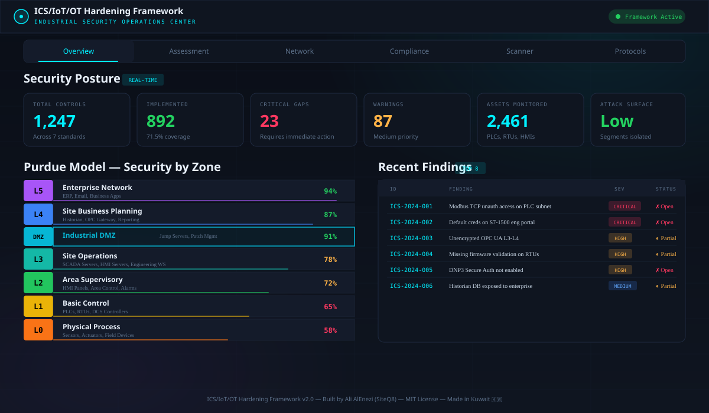
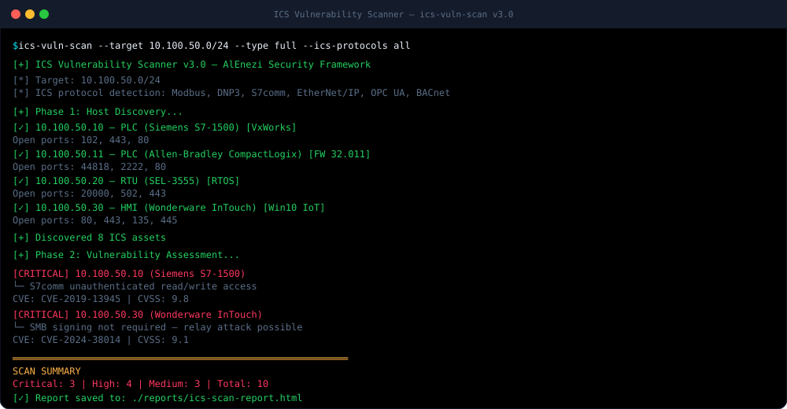
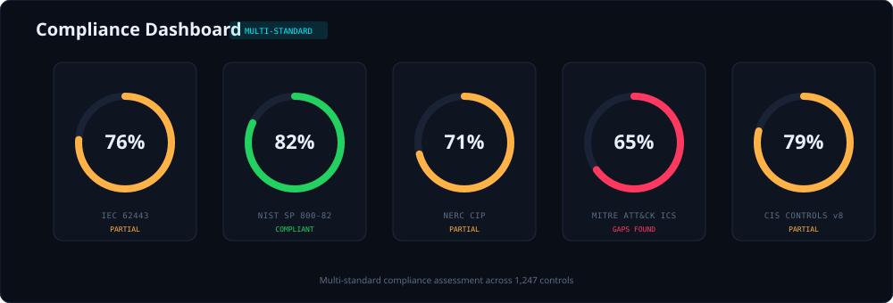
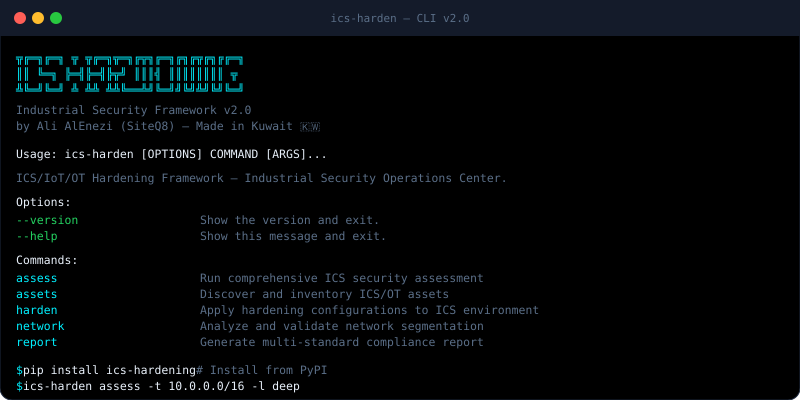

<div align="center">

# ICS/IoT/OT Hardening Framework

### The Open-Source Industrial Cybersecurity Platform

[](https://opensource.org/licenses/MIT)
[](https://github.com/SiteQ8/ics-iot-ot-hardening/releases)
[](https://www.python.org/downloads/)
[](CONTRIBUTING.md)
[](#compliance-standards)
[](#compliance-standards)
[](#compliance-standards)
[](#compliance-standards)
[](Dockerfile)
[](https://github.com/SiteQ8)

**Comprehensive security hardening toolkit for Industrial Control Systems (ICS), Internet of Things (IoT), and Operational Technology (OT) environments. Includes automated scanning, multi-standard compliance assessment, network segmentation tools, protocol security analysis, and an interactive web dashboard.**

[**🌐 Live Dashboard Demo**](https://siteq8.github.io/ics-iot-ot-hardening/gui/) · [**📖 Documentation**](docs/) · [**🐛 Report Bug**](https://github.com/SiteQ8/ics-iot-ot-hardening/issues) · [**💡 Request Feature**](https://github.com/SiteQ8/ics-iot-ot-hardening/issues)

---

</div>

## Screenshots

### Security Dashboard: Overview
<p align="center">

</p>

### ICS Vulnerability Scanner
<p align="center">

</p>

### Multi-Standard Compliance
<p align="center">

</p>

### CLI Interface
<p align="center">

</p>

---


## Dashboard Access

The interactive dashboard includes a login screen for access control:

| Credential | Username | Password |
|-----------|----------|----------|
| **Admin** | `admin` | `ICS@Secure2025` |
| **Analyst** | `analyst` | `OT@View2025` |

**Live Dashboard:** [https://siteq8.github.io/ics-iot-ot-hardening/gui/](https://siteq8.github.io/ics-iot-ot-hardening/gui/)

### Dashboard Tabs (11)

| Tab | Description |
|-----|-------------|
| **Overview** | Security posture metrics, Purdue Model, recent findings, network topology |
| **Assessment** | Interactive security assessment with scoring across IEC 62443 domains |
| **Network** | Firewall rule generator for ICS protocols (Modbus, DNP3, IEC 104, etc.) |
| **Compliance** | Multi-standard compliance gauges (NIST, IEC 62443, NERC CIP, CIS, ISA/IEC) |
| **Scanner** | ICS vulnerability scanner (demo mode) with CVE detection |
| **Protocols** | 12 ICS/SCADA protocol security reference with ports and mitigations |
| **Assets** | ICS asset inventory: 15 demo assets (PLCs, RTUs, HMIs, SIS, VFDs) with vulnerability status |
| **Incidents** | Security incident timeline: 12 demo incidents with severity classification |
| **Discovery** | Active ICS asset discovery scanner: scan by IP range or protocol (Modbus, DNP3, S7, OPC UA, MQTT, SNMP, etc.). 20 demo devices with CVE references, animated scan log |
| **SNMP** | SNMP network monitor: query devices with SNMPv1/v2c/v3, view CPU/memory/temperature/uptime, interface table, 6-point security assessment |
| **Settings** | Scan configuration, SNMP settings (auth/privacy protocols), alert thresholds, compliance standard selection, syslog/SIEM integration |

## Why This Framework?

Industrial Control Systems face unique cybersecurity challenges that traditional IT security tools don't address. This framework bridges that gap with purpose-built tools for OT environments:

- **ICS Protocol Awareness**: Understands Modbus, DNP3, S7comm, OPC UA, EtherNet/IP, BACnet, IEC 61850, and 5 more industrial protocols
- **Purdue Model Architecture**: All tools designed around the ISA-95/Purdue reference model (L0, L5 + DMZ)
- **Safety-First Approach**: Non-intrusive scanning options that respect OT availability requirements
- **Multi-Standard Compliance**: Assess against IEC 62443, NIST SP 800-82, NERC CIP, MITRE ATT&CK for ICS, and CIS Controls simultaneously
- **Real-World Tested**: Hardening scripts validated against Siemens, Allen-Bradley, Schneider, ABB, and GE environments

---

## Features

### ICS Vulnerability Scanner
Automated scanning with ICS protocol detection for PLCs, RTUs, HMIs, SCADA servers, and field devices. Supports full, quick, protocol-specific, and firmware validation scans.

### Interactive Web Dashboard
Full-featured security operations dashboard with Purdue model visualization, real-time metrics, interactive assessment tools, and compliance gauges. Deploys as a GitHub Pages site.

### Multi-Standard Compliance Engine
Simultaneous assessment against 5+ security standards with gap analysis, control mapping, and remediation tracking across 1,200+ controls.

### Firewall Rule Generator
Automated firewall rule generation for Purdue model segmentation. Outputs iptables, Cisco ASA, and Palo Alto formats.

### CLI Toolkit
Rich command-line interface with progress bars, color-coded output, and exportable reports (JSON, HTML, PDF).

### Protocol Security Analyzer
Deep inspection of 12 ICS protocols with security posture assessment per protocol, including authentication, encryption, and access control checks.

### System Hardening Scripts
Pre-built hardening scripts for Windows ICS nodes, Linux servers, SCADA applications, and HMI workstations aligned with CIS benchmarks.

### OT Network Monitoring
Real-time anomaly detection for industrial network traffic with SIEM integration connectors (Splunk, QRadar, Elastic).

### Docker Ready
Full Docker and docker-compose support for isolated deployment of all framework components.

---

## Quick Start

### Installation

**Option 1: pip install (recommended)**
```bash
pip install ics-hardening
```

**Option 2: From source**
```bash
git clone https://github.com/SiteQ8/ics-iot-ot-hardening.git
cd ics-iot-ot-hardening
pip install -e ".[full]"
```

**Option 3: Docker**
```bash
docker build -t ics-hardening .
docker run --rm ics-hardening --help
```

### First Assessment

```bash
# Discover ICS assets on your network
ics-harden assets --cidr 10.100.0.0/16

# Run a comprehensive security assessment
ics-harden assess --target 10.100.0.0/16 --level deep --output report.json

# Generate Purdue model firewall rules
ics-harden network --cidr 10.100.0.0/16

# Multi-standard compliance report
ics-harden report --format html --output compliance.html

# Launch the web dashboard
cd gui && python -m http.server 8080
# Open http://localhost:8080
```

### CLI Commands

| Command | Description |
|---------|-------------|
| `ics-harden assess` | Run ICS security assessment with configurable depth |
| `ics-harden harden` | Apply hardening configurations (supports dry-run) |
| `ics-harden network` | Network segmentation analysis and firewall generation |
| `ics-harden report` | Generate multi-standard compliance reports |
| `ics-harden assets` | Asset discovery and inventory |
| `ics-scan` | Standalone ICS vulnerability scanner |
| `ics-comply` | Standalone compliance checker |
| `ics-monitor` | Real-time OT network monitor |

---

## Architecture

```
ics-iot-ot-hardening/
├── gui/                            # 🌐 Interactive Web Dashboard (GitHub Pages)
│   └── index.html                  #    Single-page security operations center
├── src/ics_hardening/              # 📦 Python Package
│   ├── cli.py                      #    CLI entry point (Click + Rich)
│   └── modules/                    #    Framework modules
├── scripts/                        # 🔧 Automation Scripts
│   ├── assessment/                 #    Vulnerability assessment tools
│   ├── compliance/                 #    CBK/IEC/NIST compliance checkers
│   ├── networksecurity/            #    Firewall gen, traffic analyzer, scanner
│   ├── system-hardening/           #    Windows & Linux hardening scripts
│   │   ├── linux/                  #    Linux CIS benchmark hardening
│   │   └── windows/                #    Windows ICS node hardening
│   ├── siem/                       #    SIEM integration connectors
│   ├── shodan/                     #    Shodan exposure monitoring
│   └── app/                        #    SCADA/HMI app hardening
├── tools/                          # 🛠️ Custom Security Tools
│   └── asset-discovery/            #    OT asset inventory scanner
├── monitor/                        # 📡 Network Monitoring
│   └── anomaly-detector.py         #    ICS traffic anomaly detection
├── templates/                      # 📋 Configuration Templates
│   ├── firewall-rules/             #    Firewall rule templates
│   ├── policies.md                 #    Security policy templates
│   └── procedures.md               #    Operational procedures
├── docs/                           # 📖 Documentation
│   ├── screenshots/                #    Dashboard & tool screenshots
│   ├── framework.md                #    Core framework documentation
│   ├── implementation/             #    Implementation guides
│   ├── kuwait.md                   #    Kuwait/GCC specific guidance
│   └── gcc.md                      #    GCC regional considerations
├── tests/                          # ✅ Test Suite
├── docker-compose.yml              # 🐳 Multi-container deployment
├── Dockerfile                      #    Container build config
├── pyproject.toml                  #    Python packaging (PEP 621)
└── requirements.txt                #    Core dependencies
```

---

## Security Controls Coverage

### Purdue Model Zones

| Zone | Level | Description | Tools Provided |
|------|-------|-------------|----------------|
| Enterprise | L5 | ERP, Email, Business Systems | Network isolation, access policies |
| Site Business | L4 | Historian, OPC Gateway, Reporting | Data diode config, gateway hardening |
| **Industrial DMZ** | **DMZ** | **Jump Servers, Patch Management** | **Segmentation rules, jump host setup** |
| Operations | L3 | SCADA Servers, HMI Servers, Eng WS | SCADA hardening, session control |
| Supervisory | L2 | HMI Panels, Area Controllers | HMI lockdown, USB policy |
| Basic Control | L1 | PLCs, RTUs, DCS Controllers | PLC security config, firmware validation |
| Process | L0 | Sensors, Actuators, Field Devices | Physical security, tamper detection |

### ICS Protocol Security

| Protocol | Port | Risk Level | Security Features |
|----------|------|------------|-------------------|
| Modbus TCP/RTU | 502 | 🔴 Critical | No native auth/encryption |
| DNP3 | 20000 | 🟠 High | Secure Auth v5 available |
| IEC 61850 MMS | 102 | 🟠 High | GOOSE auth support |
| OPC UA | 4840 | 🟡 Medium | Built-in X.509, TLS |
| EtherNet/IP (CIP) | 44818 | 🟠 High | CIP Security extension |
| BACnet/IP | 47808 | 🟠 High | Minimal native security |
| MQTT | 1883/8883 | 🟡 Medium | TLS, ACLs available |
| CoAP | 5683/5684 | 🟡 Medium | DTLS, OSCORE |
| PROFINET | Dynamic | 🟠 High | Integrity classes |
| S7comm/S7comm+ | 102 | 🔴 Critical | S7comm+ adds crypto |
| IEC 60870-5-104 | 2404 | 🟠 High | TLS wrapper option |
| HART-IP | 5094 | 🟡 Medium | Limited auth |

---

## <a name="compliance-standards"></a>📋 Compliance Standards

This framework maps controls to the following international standards:

| Standard | Controls | Description |
|----------|----------|-------------|
| **ISA/IEC 62443** | 96 | Industrial automation and control systems security |
| **NIST SP 800-82** | 82 | Guide to ICS security (Rev. 3) |
| **NERC CIP** | 62 | Critical infrastructure protection for electric utilities |
| **MITRE ATT&CK for ICS** | 66 | Adversary tactics and techniques for ICS |
| **CIS Controls v8** | 48 | Center for Internet Security controls (OT-adapted) |
| **CBK CORF** | 876 | Kuwait Central Bank Cyber & Operational Resilience Framework |

---

## Docker Deployment

```bash
# Build and run the full stack
docker-compose up -d

# Run standalone scanner with host network access
docker-compose run --rm ics-scanner --target 10.0.0.0/24 --type full

# Run network monitor
docker-compose run --rm ics-monitor --interface eth0

# View logs
docker-compose logs -f ics-dashboard
```

---

## Contributing

Contributions are welcome! Please see the [Contributing Guidelines](CONTRIBUTING.md) for details.

**Priority areas for contribution:**
- Additional ICS protocol parsers (PROFIBUS, Foundation Fieldbus)
- Vendor-specific hardening guides (Honeywell, Yokogawa, Emerson)
- Cloud-connected OT security (Azure IoT Hub, AWS IoT Greengrass)
- OT-specific threat intelligence feeds
- Additional compliance standards (ISO 27019, IEC 62351)
- Localization and GCC/MENA regional guidance

---

## License

This project is licensed under the MIT License, see the [LICENSE](LICENSE) file for details.

## Related Resources

- [CISA ICS Advisories](https://www.cisa.gov/topics/industrial-control-systems)
- [NIST Cybersecurity Framework](https://www.nist.gov/cyberframework)
- [ISA/IEC 62443 Standards](https://www.isa.org/standards-and-publications/isa-standards/isa-iec-62443-series-of-standards)
- [MITRE ATT&CK for ICS](https://attack.mitre.org/techniques/ics/)
- [SANS ICS Security](https://www.sans.org/industrial-control-systems-security/)

---

## Author

**Ali AlEnezi (SiteQ8)**
- GitHub: [@SiteQ8](https://github.com/SiteQ8)
- Email: [site@hotmail.com](mailto:site@hotmail.com)
- Location: Kuwait 🇰🇼

---

<div align="center">


*Aligned with NIST SP 800-82 · IEC 62443 · NERC CIP · MITRE ATT&CK for ICS · CIS Controls v8*

</div>
